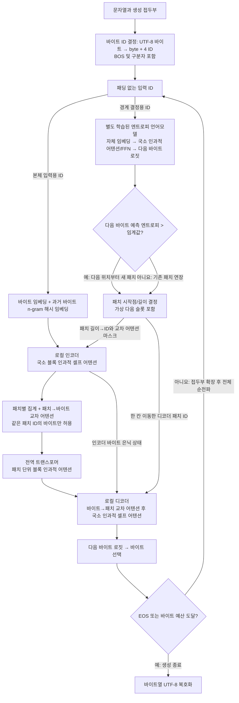
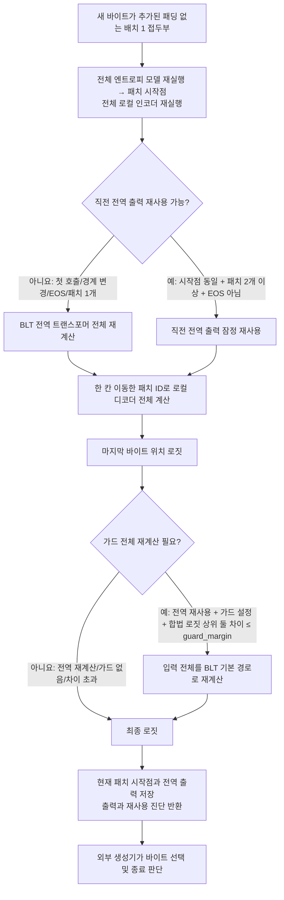

# BLT 바이트 생성 파이프라인과 어텐션 마스크

이 문서는 `phdq3`의 OSC(`attention_mode="osc"`) BLT 모델이 **패딩 없는 바이트
접두부**에서 다음 바이트를 생성하는 경로와, 이 저장소의 선택형 전역 캐시가 그
경로를 어떻게 변경하는지 설명한다. 모델 본체는 이 저장소에 없으며 어텐션과 마스크
생성은 `phdq3/blt_hf/attention.py`, `patching.py`,
`patched/modeling_blt.py`에서 수행된다. 여기의 캐시는
`src/phdq_blt_cache/global_reuse.py`와 `frontier.py`에 있다. 아래의 마스크
설명은 OSC 경로에 한정하며 다른 어텐션 모드, 패딩된 배치 또는 빔 4로 일반화하지
않는다.

## BLT 자체 작동 과정 (캐시 없음)

[BLT 논문](papers/blt.pdf) 2.3절과 3장은 패치 경계 결정에 **별도로 학습한 작은 바이트 언어모델**을
사용하고, 본체는 로컬 인코더 → 전역 패치 트랜스포머 → 로컬 디코더 순서로
동작한다고 설명한다. 다음 도식은 이 논문 구조를 현재 OSC 구현의 입력/마스크
규칙과 결합한 **생성 시 순전파**다. 논문의 학습 데이터 전처리와 혼동하지 않는다.

## 바이트 ID 결정

- 이 모델의 입력 변환은 문자열의 UTF-8 바이트값에 4를 더해 ID로 만듦.

- BLT 본체에 들어오는 값은 변환이 끝난 ID이며, OSC 경로는 패딩과 캐시 입력 조건을 별도로 검사함. ID 검사는 바이트를 다시 임베딩하는 단계가 아님.

## 바이트 해시 임베딩

- 본체 로컬 인코더는 바이트 ID를 학습된 기본 임베딩 벡터로 변환함. 경계 결정용 엔트로피 언어모델은 같은 ID를 받지만 **자체 임베딩**을 사용함.

- 테이블 조회 방식으로 벡터를 배정

- 현재 위치와 앞선 ID를 묶어 해싱(위치별 가중합을 테이블 크기로 나눈 나머지)한 후, 해시 인덱스에 해당하는 학습된 벡터를 기본 임베딩에 더함.

## 패치 경계 결정

- 바이트 ID만을 입력으로 받아 패치의 경계를 결정할 엔트로피값을 계산하는 별도의 트랜스포머 기반 신경망 작동

- 이 신경망은 local causal self-attention으로 구성(윈도우 크기=512, parameter size = 100M)

- 패치 경계는 신경망에서 계산한 엔트로피값을 고정 임계값(1.3359375)과 비교하여, 임계값을 초과하는 위치에서 경계를 설정

- 임계값은 사전학습 데이터에서 계산한 엔트로피를 기준으로 목표로 삼은 평균 패치 길이를 달성할 수 있는 값으로 결정(목표 평균 패치 길이 = 4.5)

## 로컬 인코더/디코더

- 각각의 바이트는 해시 임베딩된 벡터값과 패치ID를 가지는데, 이 바이트의 벡터값을 패치 단위로 묶어서 전역 FFN에 들어가는 입력값을 만들어주는 역할을 하는 것이 로컬 인코더

- 반대로 전역 FFN에서 나온 출력값을 분해해서 다시 바이트 단위로 환원하는 역할을 하는 것이 로컬 디코더

- 인코더에는 두 가지 어텐션이 작동한다.

	- 셀프 어텐션: EOS 구간 범위 내에서 q > 조건에 해당하는 k = 512 윈도우 내의 과거 바이트를 참조. 생성하는 벡터를 전체 문장의 문맥에 맞게 조정하는 역할을 담당

	- 패치-바이트 교차 어텐션: 패치 범위 내에서 마스킹이 일어나는 어텐션. 최종적인 임베딩 벡터값이 패치 단위로 생성되기 때문에 다른 패치의 영향을 받지 않도록 조정하는 역할을 담당

- 디코더에서는 두 가지 입력값이 두 가지 어텐션을 거치면서 최종 출력 벡터를 생성한다.
	
	- 입력값은 인코더에서 나온 은닉 상태의 벡터($h_i$)와 전역 트랜스포머가 각각 은닉 상태의 패치 하나마다 한 개씩 계산해서 생성한 벡터(context patch vector, $o_j$)

	- 교차 어텐션에서는 $h_i$를 쿼리로 사용하고 $o_j$를 키로 입력하여 벡터 생성($c_i$)

	- $c_i + h_i$를 결합한 중간 벡터 생성($u_i$)

	- 중간 벡터($u_i$)를 셀프 어텐션에 입력하여 최종 출력 벡터($v_i$) 생성

	- 이렇게 생성한 출력 벡터가 디코더의 최종 출력층을 거치면서 로짓 점수로 변환되며, 로짓 점수가 가장 높은 바이트를 다음 바이트로 예측

## 전역 트랜스포머

- 패치 단위로 임베딩한 벡터를 입력으로 받아 EOS ~ q 구간만 인과적으로 참조하는 마스킹 어텐션 수행

- 트랜스포머는 출력으로 각각의 패치에 대응하는 은닉 상태 벡터를 생성($o_j$)

## 마스크의 공통 규칙

- OSC 입력은 최소 2개의 명시적 바이트 ID가 필요하다. 입력 `attention_mask`는
  생략하거나 전부 1이어야 하며, 패딩과 모델의 `past_key_values`/`use_cache=True`
   는 허용되지 않는다. 이 입력용 1/0 마스크와 아래의 **어텐션 점수에 더하는
   마스크**는 서로 다르다.
- 점수용 마스크는 허용된 쿼리-키 쌍에 `0`, 금지된 쌍에 해당 자료형의
  `torch.finfo(dtype).min`을 더한다. 셀프 어텐션은 `[B, 1, T, T]`, 전역은
  `[B, 1, P, P]`이며 `B`는 배치, `T`는 입력 바이트 수, `P`는 패치 수다.
- `segment_ids`는 EOS(ID 2)까지를 같은 구간으로 묶고 **EOS 다음**부터
  구간 번호를 올린다. 따라서 EOS 위치는 닫는 구간에 속하며, 인과 마스크는
  다른 구간의 키를 차단한다. 여기서 말하는 EOS 구간 분리는 바이트/패치
  셀프 어텐션에 적용된다. 패치-바이트 교차 마스크는 별도의 패치 ID 일치
  규칙을 사용한다.

## 단계별 데이터와 어텐션

1. **입력과 임베딩.** 상위 생성기는 `[BOS] + 원문 + SEP + 지금까지 생성한
   바이트`를 매 단계 전달한다. `compute_hash_embeddings`가 바이트 ID로
   로컬 인코더의 입력 표현을 만든다. 임베딩 자체에는 어텐션이 없다.

2. **별도 엔트로피 모델과 경계.** 논문 2.3절은 같은 학습 분포에서 별도로
   학습한 작은 바이트 언어모델로 다음 바이트의 엔트로피를 추정한다. 논문에서
   학습 시 경계는 데이터 적재 중 전처리하고, 여기 설명하는 OSC 생성 경로는
   동결된 `BltPatcher`를 매 순전파 호출에 실행한다. 패처는 원본 바이트 ID를
   받아 **자체 임베딩 → 어텐션/FFN 층 → 로짓 → 엔트로피**를 계산한다.
   패처의 바이트 셀프 어텐션에서 쿼리 위치 `q`가
   키 위치 `k`를 볼 수 있는 조건은 `0 <= q-k < entropy_sliding_window`와
   `segment(q) == segment(k)`를 동시에 만족하는 것이다. 즉 미래, 창 밖의
   과거, EOS로 분리된 다른 구간을 가린다. 패처 로짓에서 자연로그 기반
   `-sum(p * log(p))` 엔트로피를 계산하고, 첫 바이트 다음부터 임계값을
   **초과한** 위치로 패치 시작점을 정한다. 시작점 `0, 1`과 함께 패치 길이를
   만들며 끝에는 `T+1`까지의 **다음 토큰 가상 슬롯**이 포함된다. 길이 배열의
   뒤쪽 0은 패치 패딩이다. 설정된 최대 패치 길이를 초과하면 분할한다.

3. **로컬 인코더.** 해시 임베딩과 패치 길이에서 계산한 `patch_ids`, 패치별
   교차 어텐션 마스크가 함께 로컬 인코더에 전달된다. 패치 ID를 임베딩에
   더하는 것은 아니다. 셀프 어텐션은 2단계와 동일한 EOS 구간/인과 조건을
   쓰되 창 길이는 `local_attention_window_len`이며, 패치 경계에서는 끊지
   않는다. `patch_ids`는 패치 길이의 누적 시작점을 각 바이트 위치와 비교해 얻는다.
   바이트 은닉 상태를 패치별로 집계한 뒤 패치 표현이 바이트에 교차 어텐션할
   때에는 **패치 쿼리 ID == 바이트 키의 패치 ID**인 곳만 열어 둔다.
   `cross_attn_k`개의 패치 쿼리를 사용하면 해당 허용 행을 반복한다. 교차
   마스크의 형태는 `[B, 1, P * cross_attn_k, T]`이고, 이 마스크 자체에는
   바이트별 인과 삼각형을 추가하지 않는다.

4. **전역 트랜스포머.** 패치 표현 사이의 어텐션은 `k <= q`인 과거/현재
   패치만 허용한다. EOS를 포함하는 바이트의 패치에 EOS 표시를 옮겨
   `segment(q) == segment(k)`도 검사하므로 닫힌 구간을 가로지르지 않는다.
   이 마스크에는 로컬 슬라이딩 창 제한이 없다. 캐시 미사용 경로는 매
   호출마다 전체 전역 출력을 계산한다.

5. **로컬 디코더.** 디코더는 인코더의 바이트 은닉 상태와 전역 패치 출력을
   받는다. 디코더 셀프 어텐션은 3단계의 `local_attention_window_len`
   바이트 인과/EOS 마스크를 그대로 사용한다. 패치 교차 어텐션은 원래
   `patch_ids` 대신 `patch_lengths[:, 1:]`에서 구한 `decoder_patch_ids`를
   쓴다. 디코더 바이트 쿼리 ID와 패치 키 ID가 같은 곳만 열고, 각 패치의
   `cross_attn_k`개 키에 같은 허용값을 반복한다. 마스크 형태는
   `[B, 1, T, P * cross_attn_k]`이며 교차 마스크에 별도의 삼각 마스크를
   덧씌우지 않는다. 예를 들어 `T=5`, 패치 길이 `[1, 3, 2]`라면 원래
   바이트 패치 ID는 `[0, 1, 1, 1, 2]`, 디코더 교차 ID는
   `[0, 0, 0, 1, 1]`이다. 따라서 교차 대상을 무조건 "이전 패치"라고
   단순화하면 안 된다.

## 선택형 전역 캐시 작동 과정

이 도식은 위 BLT 모델의 **호출을 일부 생략하는 경로**만 나타낸다. 기본
`use_cache=False` 경로에는 전역 결과 재사용, 로짓 가드, 디코더 KV 재사용이
없다. 캐시는 생성된 바이트를 선택하거나 문자열을 복호화하지 않는다. 캐시
입력은 패딩 없는 배치 1 접두부를 한 바이트씩 확장해야 하며, `model.eval()`과
`torch.inference_mode()`가 필요하다. 이어지지 않는 접두부는 저장된 상태를
초기화한다.

현재 OSC/BF16에서는 접두부 길이가 바뀌면 과거 엔트로피와 패치 시작점도
달라질 수 있다. 따라서 **매 바이트 전체 패처와 로컬 인코더를 재실행**하고,
시작점이 직전과 같고 패치가 둘 이상이며 마지막 ID가 EOS가 아닐 때만 전역
출력을 잠정 재사용한다. 경계가 달라지면 전역 전체를 재계산한다. 구조상 닫힌
패치가 같다는 사실만으로 BF16 은닉 상태의 동일성은 보장되지 않는다. 현재
열린 패치의 마지막 바이트가 아직 그 패치의 전역 출력을 참조하지 않는다는
관찰이 전역 재사용 분기의 근거다.

### 로짓 가드

검증된 가드 경로는 `logits_to_keep=1`, `reuse_decoder=False`다. 전역 출력을
잠정 재사용한 경우에만 마지막 위치의 로짓에서 ID `0, 1, 3`을 제외한 상위
두 합법 후보의 간격을 잰다. 간격이 `guard_margin` 이하이면 패처부터
디코더까지 전체 모델을 재실행한 로짓을 채택한다. 이때 입력 `attention_mask`는
전부 1이며, 어텐션 점수용 마스크 규칙은 BLT 기본 경로와 같다.
`guard_margin=1.0`은 한 가지 A100 검증 구성에 쓰인 실험적 휴리스틱이지
모든 입력에 대한 오차 보증이 아니다.

### 디코더 KV 재사용은 별도 실험

기본 검증 경로에서는 **디코더 KV 재사용을 끈다**. 선택적으로 켰을 때만
경계가 그대로이고 마지막 바이트가 EOS가 아니며 이전 KV가 있으면,
디코더의 `input_ids`/임베딩/위치 ID를 마지막 바이트로 줄인다. 전체 길이에
대해 준비된 디코더 셀프 어텐션 마스크와 패치 교차 마스크는 둘 다
`[:, :, -1:, :]`로 **마지막 쿼리 행만** 남긴다. 셀프 어텐션 키에는 이전
바이트의 KV가 이어지고, 교차 어텐션은 현재 전역 패치 표를 대상으로 한다.
경계가 바뀌면 전체 디코더를 다시 계산한다. 이 분기의 출력 일치나 속도를
가드 경로의 검증 결과로 간주하지 않는다.

## 근거와 적용 범위

- 마스크 생성: 상위 `phdq3/blt_hf/attention.py`의 `segment_ids`,
  `block_causal_mask`, `global_block_mask`, `require_unpadded`와
  `patched/modeling_blt.py`의 `_prepare_patch_cross_attention_mask`,
  `BltModel.forward`, `_patch_ids_from_lengths`.
- 패치 길이와 재사용 조건: 상위 `phdq3/blt_hf/patching.py` 및 이 저장소의
  `src/phdq_blt_cache/frontier.py`, `global_reuse.py`. 배경과 측정 범위는
  [설계 이력](docs/DESIGN_HISTORY.md), [인수인계](docs/HANDOFF.md),
  [개발 계획](docs/PLAN.md)을 참고한다.
- 네이티브 A100 출력 일치는 가드가 적용된 **빔 1·배치 1의 단일 검증 구성**에
  대한 결과다. 다른 모델, 데이터, 빔, GPU 또는 디코더 KV 캐싱의 동등성을
  이 문서만으로 주장할 수 없다.